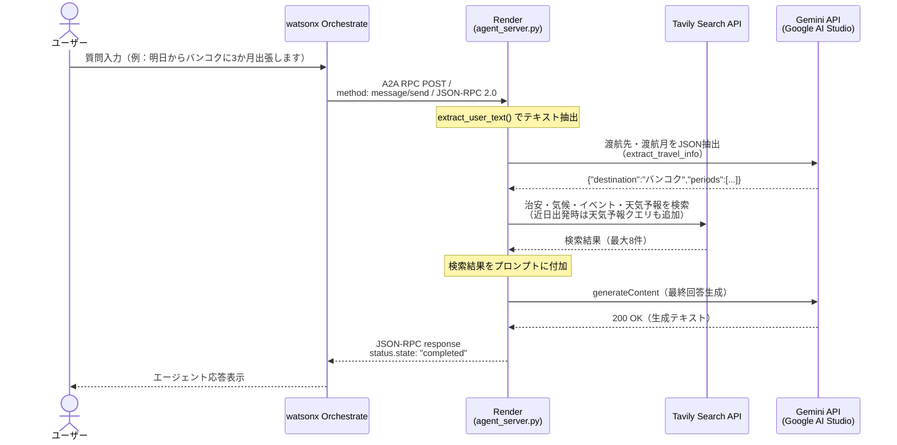

# 引継ぎドキュメント — wxo-a2a-demo

> `wxo_a2a.md` はプロジェクトの背景・目的を記載した原本です。変更不要（Readonly）。
> このファイル（`handover.md`）が作業の現在地と引継ぎ情報を管理します。

---

## ⚠️ wxO 環境操作ルール（必読・厳守）

**対象リソース以外には絶対にアクセス・更新・削除しないこと。**

| 種別 | 対象リソース名 | 備考 |
|---|---|---|
| エージェント | `M_test_A2A_gemini` | 表示名 |
| ナレッジベース | `m_test_A2A_kb` | このプロジェクトで新規作成するもの |

### 認証について
- wxO SaaS 環境への認証は**人間が行う**（Bob/AIは認証操作を行わない）
- 認証セッションは**約1時間で切れる**
- 操作前に認証が有効かどうかを確認してから進めること
- 切れていた場合は人間に再認証を依頼してから再開する

### ナレッジベースのベクトルLLM設定
- KBのベクトルLLMは**デフォルトではなく `multilingual` のものを使用**すること
- 作成時に必ず設定を確認・変更する

---

## 0. システムトポロジー（最新）



> **補足**：`TAVILY_API_KEY` 未設定時は Tavily 検索・地名抽出をスキップして直接 Gemini に渡す。

---

## 1. プロジェクトの目的（要約）

watsonx Orchestrate（wxO）から外部 A2A エージェントを接続するデモを構築する。  
デモテーマは **海外出張リスク分析**。Tavily Web 検索で最新情報（治安・気候・現地イベント等）をプロンプトに付加して Gemini に回答させる構成。

**方針の補足（オーナーより）**：
- クォータを消費するような高負荷な使い方は不要。デモとして動けばよい。
- 「外部エージェントとしての付加価値」を示すため、wxO 単体では得られない最新情報（天気・祝日・現地イベント等）を含めることが重要。

---

## 2. システム構成

| 要素 | 内容 |
|---|---|
| 呼び出し元 | watsonx Orchestrate（A2A RPC） |
| エージェントサーバー | FastAPI (`agent_server.py`) |
| ホスティング | Render 無料 Web Service（15分無通信でスリープ、復帰に30秒〜1分） |
| ソース管理 | GitHub `matsuo-iguazu/wxo-a2a-demo` |
| Web 検索 | Tavily Search API（最新情報取得） |
| LLM | Gemini API（Google AI Studio、プロジェクト `wxo-a2a`） |
| デプロイ | GitHub push → Render 自動デプロイ |

### watsonx Orchestrate 側の設定

| 項目 | 値 |
|---|---|
| エージェント名 | `M_test_A2A_gemini` |
| エージェント内定義（外部エージェント） | `海外出張リスク分析（Gemini）` |
| 外部エージェント接続名 | `M_test_A2A_gemini`（仮定義） |
| Server URL | `https://wxo-a2a-demo.onrender.com` |
| 認証 | 基本認証（Basic Auth）/ ユーザー名: `dummy` / パスワード: `dummy` |

> **注意**：Basic Auth の `dummy/dummy` は、wxO UI 上で外部エージェント接続を定義する際に認証情報の入力が必須だったため便宜上設定した仮の値。Render 側（`agent_server.py`）では認証検証を行っていないため実質素通り。

**エンドポイント一覧**：

| パス | 用途 |
|---|---|
| `POST /` | A2A RPC（`message/send` / `tasks/send`） |
| `GET /health` | 稼働確認（`tavily_configured` フィールドで Tavily の有効/無効を確認可） |
| `GET /models` | 利用可能モデル一覧（Gemini API に実際に問い合わせ） |
| `GET /.well-known/agent.json` | A2A エージェントカード |
| `GET /.well-known/agent-card.json` | 同上（別名） |

---

## 3. 調査・作業ログ

### Google Search Grounding の制約（重要）

当初 Gemini の Google Search Grounding（`search=True`）で最新情報取得を試みたが、以下の制約が判明：

| 制約 | 内容 |
|---|---|
| Search Grounding が使えるモデル | Gemini 2 / Gemini 2.5 系のみ（無料枠 RPD=1,500） |
| Gemini 3 以降 | Search Grounding RPD=0/0（利用不可） |
| Gemini 2.0-flash | 廃止済み（`404`）。`gemini-3.8-flash` を使えとのメッセージ |
| Gemini 2.5-flash-lite | 新規ユーザー向け廃止（`404`）。`gemini-3.5-flash-lite` を使えとのメッセージ |

→ **結論：無料枠では Search Grounding は事実上使えない。代替として Tavily を採用。**

### エラーパターンと対処

| エラー | 原因 | 対処 |
|---|---|---|
| `429 RESOURCE_EXHAUSTED` (search=True) | Search Grounding 専用クォータ超過 | `search=True` 失敗時に同モデルで `search=False` を試行 |
| `429 RESOURCE_EXHAUSTED` (search=False) | 通常呼び出しの RPM/RPD 超過 | 次のモデルへスキップ |
| `404 NOT_FOUND` | モデル廃止 | 自動的に次候補へスキップ |
| `503 UNAVAILABLE` | Google 側一時高負荷 | 3秒待って1回リトライ後、次候補へ |

### RPD は28日間ローリングウィンドウ

RPD は「日次リセット」ではなく **過去28日間のローリングウィンドウ**で管理されている模様。

---

## 4. 現在のコード状態

### 処理フロー

```
ユーザー入力
  ↓ extract_travel_info()  ← Gemini で JSON 解析
渡航先・渡航月リスト（年付き）を抽出
  例: {"destination": "バンコク", "periods": [{"year":2026,"month":11}, ...]}
  ↓ search_travel_context()
Tavily で3〜4クエリ検索（最大8件）：
  - {destination} 治安 安全情報 最新
  - {destination} {期間} 気候 季節
  - {destination} {期間} イベント 祝日
  - {destination} 天気予報 今週 来週  ← 出発が今月・翌月以内の場合のみ追加
  ↓ build_prompt_with_context()
検索結果をプロンプトに付加
  ↓ call_gemini()
Gemini で最終回答を生成（search=False）
  ↓
A2A レスポンスで返却
```

### モデル優先順位（`PREFERRED_MODELS`）

```python
PRIMARY_MODEL = "gemini-2.0-flash"  # 404 → 自動スキップ
PREFERRED_MODELS = [
    "gemini-2.0-flash",      # 404（廃止） → 自動スキップ
    "gemini-2.5-flash-lite", # 404（新規ユーザー廃止） → 自動スキップ
    "gemini-3.1-flash-lite", # search=True → 429、search=False → 200 OK ✅ 実質ここで動作
    "gemma-4-26b-a4b-it",    # 最終保険（search=False）
]
```

> **TODO**：`gemini-2.0-flash` と `gemini-2.5-flash-lite`（404）を除去し、`gemini-3.1-flash-lite` をプライマリに変更するとクリーンになる。現状は動作に問題ないが無駄なリクエストが発生している。

### フォールバック戦略

1. `gemini-*` → `search=True` → `429` なら `search=False` で同モデル再試行
2. `search=False` でも `429` or `404` → 次のモデルへ
3. `503` → 3秒待って1回リトライ → 失敗したら次候補へ

### 環境変数（Render）

| 変数名 | 状態 | 説明 |
|---|---|---|
| `GEMINI_API_KEY` | ✅ 設定済み | Gemini API キー |
| `TAVILY_API_KEY` | ✅ 設定済み | Tavily Search API キー |
| `SYSTEM_INSTRUCTION` | ✅ 設定済み | カスタムシステムプロンプト（下記参照） |
| `GEMINI_MODEL` | 未設定 | プライマリモデル名の上書き（未設定時はコードデフォルト） |

### SYSTEM_INSTRUCTION（現在の設定内容）

```
あなたは企業の海外出張リスク分析の専門アドバイザーです。
提供されたWeb検索結果を必ず活用し、一般的な傾向だけでなく「渡航期間の気候傾向」や「渡航時期の祝日・大型イベント・行事・直近ニュース」などの最新情報も踏まえて、以下の構成に従って簡潔かつ実務的に回答してください。

先頭に「【（渡航先名）渡航に向けた調査】」というタイトルを1行出力すること。

[サマリー表]
| 観点 | リスクレベル（低・中・高） | 最重要ポイント（1行） |
| 治安・安全 / 健康・医療 / 法規・入国手続き / 気候・行事・ビジネス環境 |

### 1. 治安・安全リスク / 2. 健康・医療 / 3. 入国・ビザ・法規 / 4. 渡航期間の気候・行事・推奨アクション

§4 の気候・行事・イベント：直近の天気予報または気候傾向と渡航期間中の祝日・イベントを引用。
天気予報の検索結果がある場合は具体的な気温・天候を記載すること。

ルール：700〜1,000文字、冗長な前置き不要、自然な日本語で。
```

---

## 5. 完成済み機能

| 機能 | 状態 | URL / 備考 |
|---|---|---|
| A2A エージェント（渡航レポート） | ✅ 完成 | `POST https://wxo-a2a-demo.onrender.com/` |
| Web アプリ（渡航レポート UI） | ✅ 完成 | `https://wxo-a2a-demo.onrender.com/ui/` |
| wxO からの A2A 呼び出し | ✅ 動作確認済み | エージェント `M_test_A2A_gemini` |
| Tavily 検索 + 渡航先・期間 JSON 解析 | ✅ 完成 | 年またぎ・近日天気予報対応 |

---

## 6. 次フェーズ：wxO エージェント拡張（完了）

### 方針

「来月バンコクに行くことになった」のような自然な発話を受けて：
1. 渡航先・期間をスロットで収集
2. 既存エージェント（Render）を呼び出してリスクレポート取得
3. 出張規程（知識ベース）を照合して規程上の注意事項を追加
4. 出張申請書ドラフトを生成して出力

### タスク一覧

- [x] **出張規程サンプルドキュメントを作成**（危険度レベル・日当・承認フロー・保険等）
  - ファイル：`knowledge-bases/travel_policy.md`（表示用）・`knowledge-bases/travel_policy.txt`（KB登録用）
- [x] **wxO 知識ベース `m_test_A2A_kb` を作成・出張規程を登録**
  - KB ID：`0a53f0e9-8c41-4980-9037-66f4732db17b`
  - 埋め込みモデル：`ibm/granite-embedding-278m-multilingual`（multilingual ✅）
  - ドキュメント：`travel_policy.txt`（1件、6.7 KB）、インデックス状態：`ready`
- [x] **エージェント `Untitled_Agent_1_0061NH`（表示名 `M_test_A2A_gemini`）を更新**
  - `knowledge_base` に `m_test_A2A_kb` を追加
  - `instructions` を出張リスクレポート・規程照合・申請書ドラフト生成の3機能対応に拡張
  - スターターポロンプト・ウェルカムメッセージも日本語対応に更新
  - **規程照合ロジック**：危険度レベル3・4の地域 → 「出張不可」を明示
  - **申請書ドラフト生成**：渡航先・期間・目的等を収集して申請書フォーマット出力
- [ ] **PREFERRED_MODELS の整理**：404 になる `gemini-2.0-flash` と `gemini-2.5-flash-lite` を除去し、`gemini-3.1-flash-lite` をプライマリに戻す

### 追加アイデア（将来）
- 中東・危険地域の出張申請 → 「規程により出張不可」を返すデモ（インパクト大）✅ 規程照合ロジック実装済みで対応可能

### wxO エージェント構成（更新後）

| 項目 | 値 |
|---|---|
| 内部 name | `Untitled_Agent_1_0061NH` |
| 表示名 | `M_test_A2A_gemini` |
| ID | `11c04a11-f68f-4ac9-9d48-6d5c4364513d` |
| LLM | `bedrock/us.anthropic.claude-sonnet-4-6` |
| collaborators | `agent_Gemini__4373as`（外部A2Aエージェント） |
| knowledge_base | `m_test_A2A_kb` |
| instructions | 出張リスクレポート・規程照合・申請書ドラフト生成の3機能対応 |

### ナレッジベース KB ファイル

| ファイル | 内容 |
|---|---|
| `knowledge-bases/travel_policy.md` | 出張規程サンプル（表示用・ソース管理用） |
| `knowledge-bases/travel_policy.txt` | KB 登録用（.md は非サポートのため .txt でコピー） |
| `knowledge-bases/m_test_A2A_kb.yaml` | KB スペックファイル（絶対パス版） |
| `knowledge-bases/m_test_A2A_kb_nodocs.yaml` | KB スペックファイル（相対パス版・実際に使用） |
| `agents/M_test_A2A_gemini_export.yaml` | エージェントエクスポート（更新前バックアップ） |
| `agents/M_test_A2A_gemini_updated.yaml` | エージェント更新用 YAML |

---

## 6. クォータリセットポリシー（Google AI Studio 無料枠）

| 種別 | リセット間隔 | 詳細 |
|---|---|---|
| **RPM**（1分あたり） | **1分ごと**（ローリングウィンドウ） | 1分待てば即回復 |
| **RPD**（1日あたり） | **過去28日間ローリングウィンドウ** | 使った分だけ28日間残る |

---

## 7. Render ダッシュボードへのアクセス手順

1. https://dashboard.render.com を開く
2. **「GitHub でログイン」** を選択（GitHub アカウントで認証）
3. サービス一覧から **`wxo-a2a-demo`** を選択

| タブ | 用途 |
|---|---|
| **Logs** | リアルタイムログ（Tavily 検索クエリ・件数・モデルの成功/失敗） |
| **Environment** | 環境変数の確認・変更（`GEMINI_API_KEY`, `TAVILY_API_KEY`, `SYSTEM_INSTRUCTION`） |
| **Events** | デプロイ履歴 |

> **Tips**：GitHub に push すると自動デプロイ。`SYSTEM_INSTRUCTION` の変更はデプロイ不要で即時反映。

---

## 8. 参考リンク

- Render URL：https://wxo-a2a-demo.onrender.com
- GitHub：https://github.com/matsuo-iguazu/wxo-a2a-demo
- クォータ確認：https://ai.dev/rate-limit
- Tavily：https://app.tavily.com
