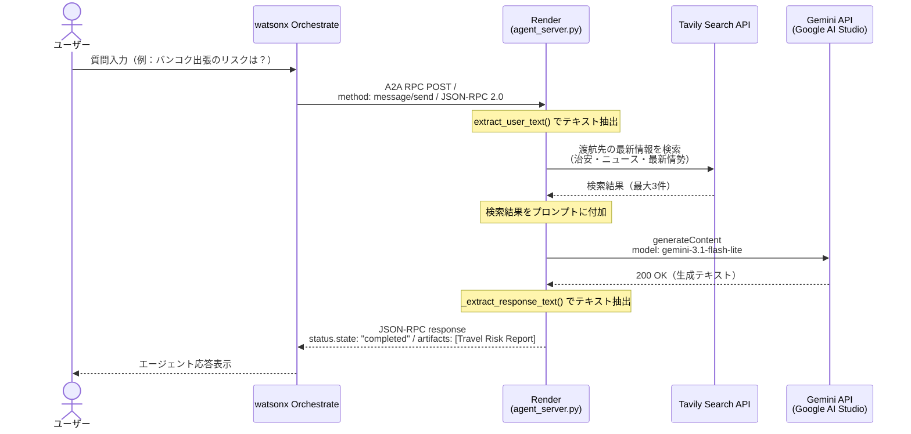

# 引継ぎドキュメント — wxo-a2a-demo

> `wxo_a2a.md` はプロジェクトの背景・目的を記載した原本です。変更不要（Readonly）。
> このファイル（`handover.md`）が作業の現在地と引継ぎ情報を管理します。

---

## 0. システムトポロジー（最新）



> **補足**：`TAVILY_API_KEY` 未設定時は Tavily 検索をスキップして直接 Gemini に渡す。

---

## 1. プロジェクトの目的（要約）

watsonx Orchestrate（wxO）から外部 A2A エージェントを接続するデモを構築する。  
デモテーマは **海外出張リスク分析**。モデルの静的な知識だけでなく、**Tavily Web 検索**で最新情報（治安・ニュース・現地イベント等）をプロンプトに付加して Gemini に回答させる構成。

**方針の補足（オーナーより）**：
- クォータを消費するような高負荷な使い方は不要。デモとして動けばよい。
- 「外部エージェントとしての付加価値」を示すため、wxO 単体では得られない最新情報（天気・祝日・現地イベント等）を含めることが重要。

---

## 2. システム構成

| 要素 | 内容 |
|---|---|
| 呼び出し元 | watsonx Orchestrate（A2A RPC） |
| エージェントサーバー | FastAPI (`agent_server.py`) |
| ホスティング | Render 無料 Web Service（15分無通信でスリープ、復帰に30秒〜1分） |
| ソース管理 | GitHub `matsuo-iguazu/wxo-a2a-demo` |
| Web 検索 | Tavily Search API（最新情報取得） |
| LLM | Gemini API（Google AI Studio、プロジェクト `wxo-a2a`） |
| デプロイ | GitHub push → Render 自動デプロイ |

### watsonx Orchestrate 側の設定

| 項目 | 値 |
|---|---|
| エージェント名 | `M_test_A2A_gemini` |
| エージェント内定義（外部エージェント） | `海外出張リスク分析（Gemini）` |
| 外部エージェント接続名 | `M_test_A2A_gemini`（仮定義） |
| Server URL | `https://wxo-a2a-demo.onrender.com` |
| 認証 | 基本認証（Basic Auth）/ ユーザー名: `dummy` / パスワード: `dummy` |

> **注意**：Basic Auth の `dummy/dummy` は、wxO UI 上で外部エージェント接続を定義する際に認証情報の入力が必須だったため便宜上設定した仮の値。Render 側（`agent_server.py`）では認証検証を行っていないため実質素通り。

**エンドポイント一覧**：

| パス | 用途 |
|---|---|
| `POST /` | A2A RPC（`message/send` / `tasks/send`） |
| `GET /health` | 稼働確認・設定確認（`tavily_configured` フィールドで Tavily の有効/無効を確認可） |
| `GET /models` | 利用可能モデル一覧（Gemini API に実際に問い合わせ） |
| `GET /.well-known/agent.json` | A2A エージェントカード |
| `GET /.well-known/agent-card.json` | 同上（別名） |

---

## 3. 調査・作業ログ（2026-11-19 〜 2026-11-20）

### Google Search Grounding の制約（重要）

当初 Gemini の Google Search Grounding（`search=True`）で最新情報取得を試みたが、以下の制約が判明した：

| 制約 | 内容 |
|---|---|
| Search Grounding が使えるモデル | Gemini 2 / Gemini 2.5 系のみ（無料枠 RPD=1,500） |
| Gemini 3 以降 | Search Grounding RPD=0/0（利用不可） |
| Gemini 2.0-flash | 廃止済み（`404 NOT_FOUND`）。`gemini-3.8-flash` を使えとメッセージあり |
| Gemini 2.5-flash-lite | 新規ユーザー向け廃止（`404 NOT_FOUND`）。`gemini-3.5-flash-lite` を使えとメッセージあり |

→ **結論：無料枠では Search Grounding は事実上使えない。課金なしの代替手段として Tavily を採用。**

### エラーパターンと対処

| エラー | 原因 | 対処 |
|---|---|---|
| `429 RESOURCE_EXHAUSTED` (search=True) | Search Grounding 専用クォータ超過 or RPM超過 | `search=True` 失敗時に同モデルで `search=False` を試行するよう修正済み |
| `429 RESOURCE_EXHAUSTED` (search=False) | 通常呼び出しの RPM/RPD 超過 | 次のモデルへスキップ |
| `404 NOT_FOUND` | モデル廃止 | 自動的に次候補へスキップ（エラー処理済み） |
| `503 UNAVAILABLE` | Google 側一時高負荷 | 3秒待って1回リトライ後、次候補へ |

### RPD は28日間ローリングウィンドウ

RPD（1日あたり上限）は「日次リセット」ではなく **過去28日間のローリングウィンドウ**で管理されている模様（Google AI Studio のレート制限ページで確認）。

---

## 4. 現在のコード状態

### 処理フロー

```
ユーザー入力
  ↓ build_prompt_with_context()
Tavily で「{入力} 渡航 治安 最新情報 2025」を検索（最大3件）
  ↓
検索結果をプロンプトに付加（未設定時はスキップ）
  ↓ call_gemini()
gemini-3.1-flash-lite (search=False) で回答生成
  ↓
A2A レスポンスで返却
```

### モデル優先順位（`agent_server.py` の `PREFERRED_MODELS`）

```python
PRIMARY_MODEL = "gemini-2.0-flash"  # 環境変数 GEMINI_MODEL で上書き可
                                     # ※ 404 になるため実質 gemini-3.1-flash-lite が使われる

PREFERRED_MODELS = [
    "gemini-2.0-flash",      # 404（廃止） → 自動スキップ
    "gemini-2.5-flash-lite", # 404（新規ユーザー廃止） → 自動スキップ
    "gemini-3.1-flash-lite", # search=True → 429、search=False → 200 OK ✅ 実質ここで動作
    "gemma-4-26b-a4b-it",    # 最終保険（search=False）
]
```

> **TODO**：`PRIMARY_MODEL` のデフォルトを `gemini-3.1-flash-lite` に戻すか、PREFERRED_MODELS から 404 モデルを除くとクリーンになる。現状は動作に問題ないが無駄なリクエストが発生している。

### フォールバック戦略

1. `gemini-*` → `search=True` で試行 → `429` なら `search=False` で同モデル再試行
2. `search=False` でも `429` → 次のモデルへスキップ
3. `404` → 次のモデルへスキップ
4. `503` → 3秒待って1回リトライ → 失敗したら次候補へ
5. `gemma-*` → `search=False` のみ

### 環境変数（Render）

| 変数名 | 状態 | 説明 |
|---|---|---|
| `GEMINI_API_KEY` | ✅ 設定済み | Gemini API キー |
| `TAVILY_API_KEY` | ✅ 設定済み | Tavily Search API キー |
| `SYSTEM_INSTRUCTION` | ✅ 設定済み | カスタムシステムプロンプト（詳細な指示） |
| `GEMINI_MODEL` | 未設定 | プライマリモデル名の上書き（未設定時はコードデフォルト） |

---

## 5. 残課題・次のアクション

### 優先度 高
- [ ] **wxO からのエンドツーエンド確認**：watsonx Orchestrate からの呼び出しで Tavily 検索結果を含む応答が表示されるか確認する

### 優先度 中
- [ ] **PREFERRED_MODELS の整理**：404 になる `gemini-2.0-flash` と `gemini-2.5-flash-lite` を除去し、`gemini-3.1-flash-lite` をプライマリに戻す
- [ ] **応答品質の確認**：Tavily の検索結果が実際に回答に反映されているか（天気・最新ニュース・現地イベント）を人間の目で確認する

### 参考リンク
- Render URL：https://wxo-a2a-demo.onrender.com
- Render ダッシュボード：https://dashboard.render.com（GitHub でログイン → `wxo-a2a-demo` を選択）
- GitHub：https://github.com/matsuo-iguazu/wxo-a2a-demo
- クォータ確認：https://ai.dev/rate-limit
- Tavily：https://app.tavily.com

---

## 6. クォータリセットポリシー（Google AI Studio 無料枠）

| 種別 | リセット間隔 | 詳細 |
|---|---|---|
| **RPM**（1分あたり） | **1分ごと**（ローリングウィンドウ） | 1分待てば即回復 |
| **RPD**（1日あたり） | **過去28日間ローリングウィンドウ**（日次リセットではない） | 使った分だけ28日間残る |

- `429` が出ても RPM 超過であれば **1〜2分待つだけで回復** する。
- RPD は日次リセットではないため、使い切ったら28日間待つ必要がある（ただし `gemini-3.1-flash-lite` は RPD=500 と余裕大）。

---

## 7. Render ダッシュボードへのアクセス手順

1. https://dashboard.render.com を開く
2. **「GitHub でログイン」** を選択（GitHub アカウントで認証）
3. 左メニューまたはトップページのサービス一覧から **`wxo-a2a-demo`** を選択
4. 主要タブの使い方：

| タブ | 用途 |
|---|---|
| **Logs** | リアルタイムログ確認（Tavily 検索結果件数、モデルの成功/失敗） |
| **Environment** | 環境変数の確認・変更（`GEMINI_API_KEY`, `TAVILY_API_KEY` など） |
| **Events** | デプロイ履歴の確認 |
| **Settings** | サービス設定（GitHub リポジトリ連携、自動デプロイ設定など） |

> **Tips**：GitHub に push すると自動デプロイが走る。Logs タブで `==> Your service is live 🎉` が出ればデプロイ完了。
